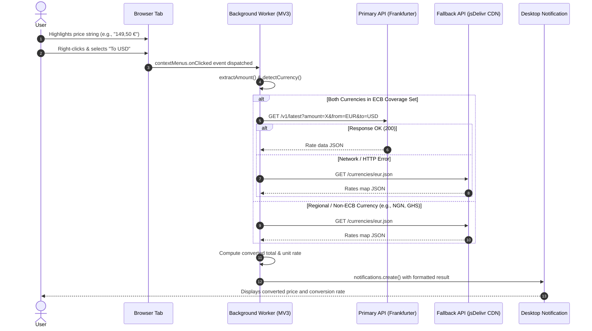
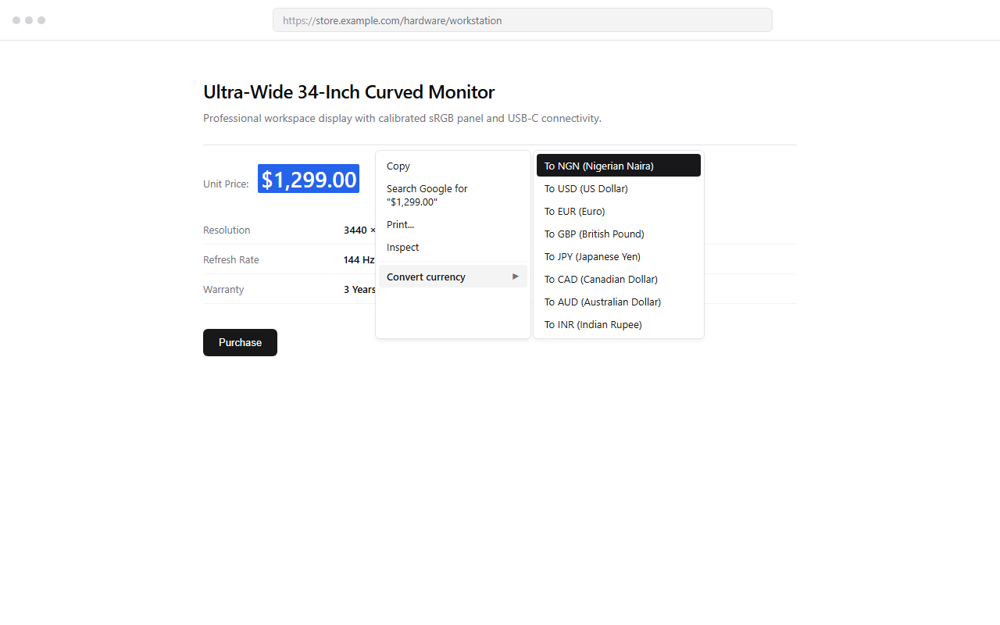
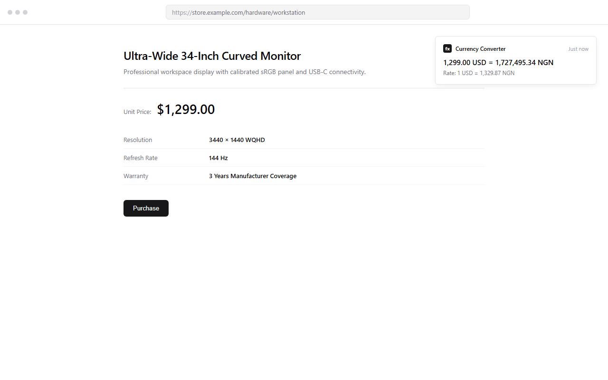
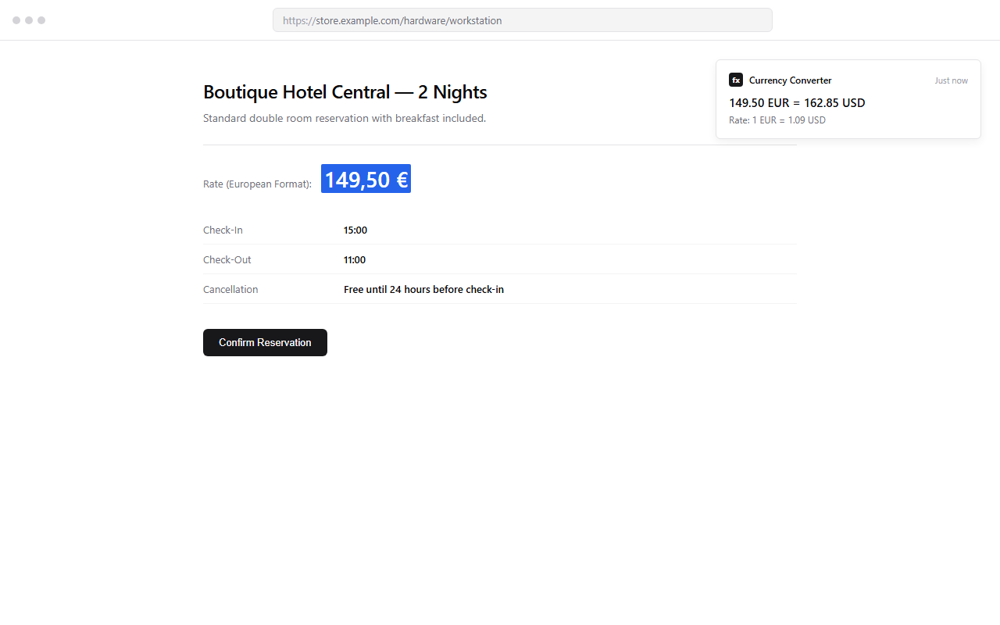

# Currency Converter

[](https://developer.chrome.com/docs/extensions/mv3/intro/)
[](LICENSE)
[](#cross-browser-compatibility)
[](#test-suite)

A high-performance, cross-browser extension built on Manifest V3 that enables in-page price conversion directly through the browser context menu. Features dual-tier foreign exchange rate routing and zero DOM mutation.

---

## Table of Contents

- [Overview](#overview)
- [System Architecture](#system-architecture)
- [Key Features](#key-features)
- [Supported Currencies](#supported-currencies)
- [Visual Verification](#visual-verification)
- [Cross-Browser Compatibility](#cross-browser-compatibility)
- [Directory Structure](#directory-structure)
- [Installation and Local Development](#installation-and-local-development)
  - [Google Chrome, Microsoft Edge, and Brave](#google-chrome-microsoft-edge-and-brave)
  - [Mozilla Firefox](#mozilla-firefox)
- [Build Pipeline](#build-pipeline)
- [Test Suite](#test-suite)
- [Security and Privacy Architecture](#security-and-privacy-architecture)
- [API Reference and Upstream Providers](#api-reference-and-upstream-providers)
- [Store Assets and Distribution](#store-assets-and-distribution)
- [Contributing](#contributing)
- [License](#license)

---

## Overview

Currency Converter streamlines international pricing lookups on web pages. Instead of copying numbers into search engines, switching tabs, or relying on intrusive floating widgets, users highlight any monetary value on a page, right-click, and select their target currency.

The extension processes selections purely in memory within the background service worker or script, fetches live exchange rates via an automated dual-API fallback architecture, and presents formatted results through native desktop notifications.

### Design Principles

1. **Zero DOM Mutation**: The extension does not inject content scripts, styles, or iframes into third-party web pages.
2. **Ephemeral Memory Execution**: Highlighted strings exist only in volatile service worker memory during parsing and conversion.
3. **Dual-API Reliability**: High-frequency Central Bank reference rates are paired with a CDN-cached fallback table covering 170+ global currencies.
4. **Universal Manifest V3 Compatibility**: Single shared business logic layer compiled to target both Chromium service workers and Firefox event scripts.

---

## System Architecture

The following sequence outlines the conversion pipeline from user selection to notification delivery:



### Architectural Highlights

- **Parsing Pipeline**: Employs a two-pass tokenization algorithm that handles complex international digit grouping, inverted decimal separators (such as European dot-thousands and comma-decimals), multi-character symbols (`CAD$`, `AU$`, `zł`), and ISO 4217 currency tokens.
- **Fault-Tolerant Routing**: Queries European Central Bank reference data via the Frankfurter API for optimal low-latency conversion across 30+ major liquid pairs. Automatically fails over to the open currency database via jsDelivr CDN for emerging market and regional currencies.

---

## Key Features

- **Context Menu Interaction**: Submenu integrated directly into the browser context menu under the `selection` context.
- **Broad Currency Coverage**: Immediate support for 170+ national and regional currencies.
- **International Number Parsing**:
  - Handles standard dot-decimal notation: `$1,299.99` &rarr; `1299.99`
  - Handles European comma-decimal notation: `149,50 €` &rarr; `149.50`
  - Handles full European mixed formatting: `1.299,99 €` &rarr; `1299.99`
  - Handles comma-separated thousands: `₦50,000` &rarr; `50000`
- **Native Notification Presentation**: Clear desktop alerts formatted using `Intl.NumberFormat` localized for standard financial clarity.
- **Zero Telemetry**: No logging, no remote tracking beacons, no analytics collectors, and no persistent disk storage.

---

## Supported Currencies

### Native Primary Target Submenus

The context menu provides one-click target conversion to the following currencies:

| Code | Currency Name | Typical Symbol | Routing Layer |
|---|---|---|---|
| **NGN** | Nigerian Naira | `₦` | Fawaz Fallback API |
| **USD** | United States Dollar | `$` | Frankfurter (ECB) |
| **EUR** | Euro | `€` | Frankfurter (ECB) |
| **GBP** | British Pound Sterling | `£` | Frankfurter (ECB) |
| **JPY** | Japanese Yen | `¥` | Frankfurter (ECB) |
| **CAD** | Canadian Dollar | `CAD$` / `CA$` | Frankfurter (ECB) |
| **AUD** | Australian Dollar | `AU$` / `A$` | Frankfurter (ECB) |
| **INR** | Indian Rupee | `₹` | Frankfurter (ECB) |

### Detected Source Currencies

The automatic detection engine recognizes 170+ ISO 4217 currency codes and common currency symbols, including `CHF`, `ZAR`, `SGD`, `HKD`, `NZD`, `SEK`, `NOK`, `DKK`, `PLN` (`zł`), `CZK` (`Kč`), `TRY`, `BRL` (`R$`), `MXN`, `KRW` (`₩`), `GHS`, `KES`, and others.

---

## Visual Verification

### 1. In-Page Context Menu Trigger
Users highlight an item price on any web store and access the target conversion submenu with a single right-click.



### 2. Live Conversion Alert
The conversion result displays the total converted value alongside the calculated unit exchange rate in a system notification.



### 3. European Number Format Normalization
The parser accurately identifies comma-based decimal delimiters common in European e-commerce stores without calculation distortion.



---

## Cross-Browser Compatibility

| Browser | Engine | Manifest Support | Build Target | Verification Status |
|---|---|---|---|---|
| **Google Chrome** | Chromium | Manifest V3 (Service Worker) | `dist/chrome` | Verified |
| **Microsoft Edge** | Chromium | Manifest V3 (Service Worker) | `dist/chrome` | Verified |
| **Brave** | Chromium | Manifest V3 (Service Worker) | `dist/chrome` | Verified |
| **Mozilla Firefox** | Gecko | Manifest V3 (Background Scripts) | `dist/firefox` | Verified |
| **Opera** | Chromium | Manifest V3 (Service Worker) | `dist/chrome` | Verified |
| **Vivaldi** | Chromium | Manifest V3 (Service Worker) | `dist/chrome` | Verified |

---

## Directory Structure

```
currency-converter-v2/
├── .agents/                    # Workspace agent configurations and skills
├── dist/                       # Compiled distribution outputs
│   ├── chrome/                 # Unpacked Chromium build (MV3)
│   ├── firefox/                # Unpacked Firefox build (MV3)
│   └── packages/               # Production upload ZIP archives
│       ├── currency-converter-chrome-v1.1.0.zip
│       └── currency-converter-firefox-v1.1.0.zip
├── screenshots/                # Verification captures and Chrome Web Store tiles
├── scripts/                    # Asset and graphic compilation utilities
├── src/                        # Primary source files
│   ├── background.js           # Universal cross-browser background worker
│   └── icons/                  # High-DPI icons (16px, 48px, 96px, 128px)
├── tests/                      # Automated unit test suite
│   └── parse.test.js           # Unit tests for currency detection & amount parsing
├── build.js                    # Cross-browser build and packaging script
├── package.json                # Project manifest and task automation
├── CHROMEWEBSTORE.md           # Chrome Web Store submission metadata and declarations
├── PRIVACY_POLICY.md           # Public privacy policy
├── DESIGN.md                   # Architectural and visual design constraints
├── LICENSE                     # MIT License
└── README.md                   # Project technical documentation
```

---

## Installation and Local Development

### Prerequisites

- [Node.js](https://nodejs.org/) v18.0.0 or higher.
- A modern Chromium-based browser or Mozilla Firefox.

### Google Chrome, Microsoft Edge, and Brave

1. Clone or download this repository:
   ```bash
   git clone https://github.com/richmondsogo/currency-converter-v2.git
   cd currency-converter-v2
   ```
2. Build the distribution assets:
   ```bash
   npm run build
   ```
3. Open the browser extensions manager:
   - Chrome: Navigate to `chrome://extensions/`
   - Edge: Navigate to `edge://extensions/`
   - Brave: Navigate to `brave://extensions/`
4. Toggle **Developer mode** in the upper-right corner.
5. Click **Load unpacked**.
6. Select the `dist/chrome` directory from this repository.

### Mozilla Firefox

1. Open Firefox and navigate to `about:debugging#/runtime/this-firefox`.
2. Click **Load Temporary Add-on...**.
3. Select `dist/firefox/manifest.json`.

---

## Build Pipeline

The project includes an automated build script (`build.js`) that synchronizes icons, compiles platform-specific manifests, and bundles store-ready ZIP archives.

Run the build pipeline:

```bash
npm run build
```

### Build Outputs

- `dist/chrome/`: Ready for direct Chromium unpacked loading.
- `dist/firefox/`: Ready for Firefox temporary add-on loading.
- `dist/packages/currency-converter-chrome-v1.1.0.zip`: Formatted archive with `manifest.json` at root level for the Chrome Web Store Developer Dashboard.
- `dist/packages/currency-converter-firefox-v1.1.0.zip`: Formatted archive for Firefox Add-ons (AMO).

---

## Test Suite

The project includes a regression test suite covering the numeric parser, regional formatting, symbol collision, and ISO tokenization.

Execute the test suite:

```bash
npm test
```

### Coverage Assertions

- ISO 4217 symbol precedence (e.g., verifying `CAD$` parses as `CAD` before matching `$`).
- European inverted comma-decimal structures (`1.299,99 €` and `149,50 €`).
- Anglo-American dot-decimal structures (`$1,299.99`).
- Whitespace stripping and thousands separator normalization.
- In-memory bounds validation for zero and non-numeric inputs.

---

## Security and Privacy Architecture

### Minimal Permission Footprint

Currency Converter adheres strictly to the Principle of Least Privilege:

| Permission | Scope | Justification |
|---|---|---|
| `contextMenus` | API | Creates the right-click "Convert currency" menu item on selected text. |
| `notifications` | API | Renders the converted price notification without modifying web page DOM trees. |
| `https://api.frankfurter.dev/*` | Host | Queries European Central Bank daily reference exchange rates. |
| `https://cdn.jsdelivr.net/*` | Host | Queries open currency exchange rate tables for regional currencies. |

### Security Guarantees

- **No Content Scripts**: The extension has no access to page DOMs, stored cookies, session storage, or user keystrokes.
- **No Remote Code Execution**: All executable code is packaged locally within the extension bundle in strict compliance with Chrome Web Store and Mozilla Add-on policies.
- **No Background Telemetry**: Zero analytics pings, diagnostic reporting, or tracking pixels.

---

## API Reference and Upstream Providers

1. **[Frankfurter API](https://api.frankfurter.dev)**
   - **Provider**: Open source, tracking European Central Bank (ECB) data.
   - **Authentication**: Keyless, open access.
   - **Endpoint**: `https://api.frankfurter.dev/v1/latest?amount={amount}&from={from}&to={to}`
   - **Update Frequency**: Published daily around 16:00 CET on working days.

2. **[Fawaz Ahmed Currency API](https://github.com/fawazahmed0/exchange-api)**
   - **Provider**: Open exchange rate database distributed via jsDelivr CDN.
   - **Authentication**: Keyless, open access.
   - **Endpoint**: `https://cdn.jsdelivr.net/npm/@fawazahmed0/currency-api@latest/v1/currencies/{code}.json`
   - **Coverage**: 170+ world currencies including emerging markets.

---

## Store Assets and Distribution

Pre-rendered visual assets conforming to store guidelines are stored in `screenshots/`:

- **Store Icon** (`dist/chrome/icons/icon128.png`): High-DPI 128x128 PNG icon.
- **Promo Tile** (`screenshots/promo-small-440x280.png`): 440x280 PNG small promo banner.
- **Screenshot 1** (`screenshots/real-work-test-context-menu.png`): 1280x800 PNG demonstrating context menu interaction.
- **Screenshot 2** (`screenshots/real-work-test-conversion-alert.png`): 1280x800 PNG showing notification output.
- **Screenshot 3** (`screenshots/real-work-test-european-decimal.png`): 1280x800 PNG displaying European number formatting support.

For complete store submission copy and compliance declarations, see [CHROMEWEBSTORE.md](CHROMEWEBSTORE.md).

---

## Contributing

Contributions, bug reports, and currency mapping suggestions are welcome:

1. Fork the repository.
2. Create a feature branch (`git checkout -b feature/currency-improvement`).
3. Commit your changes (`git commit -m "feat: add support for currency XYZ"`).
4. Run regression tests (`npm test`).
5. Push to the branch (`git push origin feature/currency-improvement`).
6. Open a Pull Request.

---

## License

This project is licensed under the MIT License. See [LICENSE](LICENSE) for full details.
